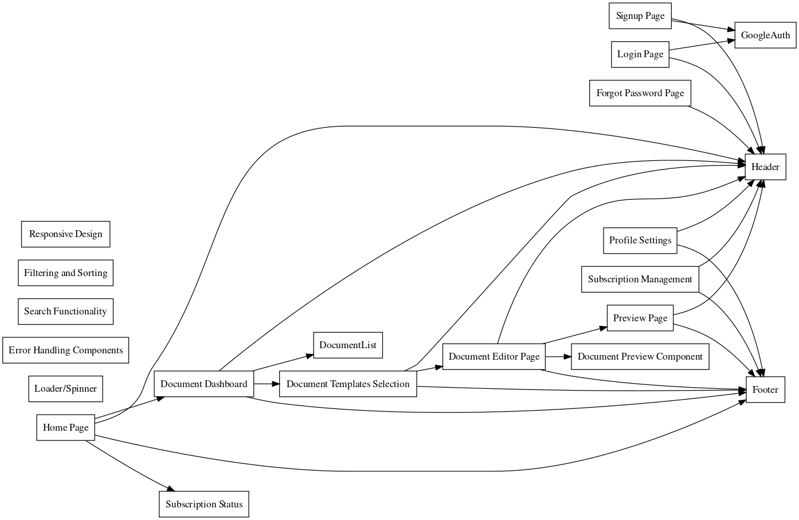

# SwiftDocs: Document Creation Platform

**Author:** Mujtaba Chaudhry  
**Date:** \today

## Executive Summary
Our platform aims to revolutionize document creation for professionals and businesses by providing streamlined solutions powered by AI technologies. Users can effortlessly generate various documents such as invoices, quotes, cover letters, business proposals, and contract agreements. Our integrated approach incorporates customizable templates tailored to different document types, ensuring efficiency and professionalism in every document.

## Platform Architecture
Our platform is built on a robust and scalable architecture that ensures reliability, security, and performance. The architecture consists of several components working together seamlessly to deliver a comprehensive document creation solution:

### Backend
The backend infrastructure is powered by Supabase, a powerful platform that combines the functionalities of a database, authentication system, and API gateway. Supabase offers a secure and scalable backend solution, eliminating the need for complex server management and infrastructure setup. It provides robust authentication mechanisms, ensuring that user data remains protected at all times. Additionally, Supabase's built-in API capabilities enable seamless communication between the frontend and backend, facilitating smooth data exchange and processing.

#### Authentication
User authentication is handled using Google OAuth, a widely-adopted authentication protocol that offers secure and seamless authentication for users. By integrating Google OAuth with our platform, we ensure that users can sign in securely using their Google accounts, eliminating the need for separate login credentials and enhancing the overall user experience.

#### Database
Supabase serves as the primary data storage solution for our platform, storing user data, document metadata, templates, and other essential information. Supabase's relational database management system (RDBMS) ensures data integrity, consistency, and reliability, enabling efficient data retrieval and manipulation operations. With Supabase, we can easily scale our database infrastructure to accommodate growing data volumes and user traffic, ensuring optimal performance and responsiveness.

- **User:**
  - ID (Primary Key)
  - Username
  - Email
  - Password (Hashed)
  - Role (e.g., admin, standard)
  - CreatedAt
  - UpdatedAt

- **Profile:**
  - UserID (Foreign Key to User)
  - FirstName
  - LastName
  - PhoneNumber
  - Address

- **Document:**
  - ID (Primary Key)
  - UserID (Foreign Key to User)
  - Title
  - Type (e.g., invoice, quote, cover letter, proposal, contract)
  - Content
  - CreatedAt
  - UpdatedAt

- **Invoice:**
  - DocumentID (Foreign Key to Document)
  - Customer
  - Amount
  - DueDate

- **Quote:**
  - DocumentID (Foreign Key to Document)
  - Customer
  - Description
  - EstimatedAmount

- **CoverLetter:**
  - DocumentID (Foreign Key to Document)
  - RecipientName
  - Position
  - CompanyName
  - Body

- **BusinessProposal:**
  - DocumentID (Foreign Key to Document)
  - Title
  - ClientName
  - Description
  - ProposalContent

- **ContractAgreement:**
  - DocumentID (Foreign Key to Document)
  - Party1Name
  - Party2Name
  - ContractTerms
  - EffectiveDate
  - ExpiryDate

#### API
Supabase provides a powerful API gateway that enables seamless interaction between the frontend and backend components of our platform. The API exposes endpoints for various operations such as user authentication, document generation, template management, and subscription management. By leveraging Supabase's API capabilities, we can implement robust and efficient communication protocols, ensuring fast and reliable data exchange between different parts of the platform.

#### Document Generation
Our platform utilizes the OpenAI API to seamlessly generate professional-grade documents for users. Users input their requirements, and the API generates LaTeX code based on predefined templates. This code is then processed by our system, compiled into PDF format, and presented to users as final documents. This streamlined process ensures consistency and professionalism across all documents while allowing users to focus on their business without worrying about document creation.

.png)

#### Subscription Management
To manage user subscriptions and payments, we leverage the Stripe Payments platform, a leading provider of online payment processing solutions. Stripe offers a comprehensive suite of tools and services for subscription management, billing, and revenue optimization, allowing us to streamline the subscription management process and provide a seamless payment experience for our users. With Stripe, users can easily subscribe to our platform, upgrade or downgrade their subscription plans, and manage their payment preferences with confidence and security. Additionally, Stripe's robust reporting and analytics features enable us to gain valuable insights into user behavior, payment trends, and revenue performance, empowering us to optimize our subscription offerings and drive business growth.

By combining these components into a unified architecture, we create a powerful and versatile platform that delivers exceptional value to our users. With its intuitive user interface, intelligent document generation capabilities, and robust subscription management features, our platform enables professionals and businesses to streamline their document creation processes, save time and effort, and focus on what matters most – growing their business.

.png)

### Frontend
The frontend of our platform is developed using React and Next.js, two modern and widely-used JavaScript frameworks. This choice of technology allows us to create a responsive and intuitive user interface that delivers a seamless user experience across different devices and screen sizes. By leveraging the latest web development practices and design principles, we ensure that users can easily navigate the platform, interact with its features, and create documents with minimal effort.

## Pricing Plans
### Basic Plan
- **Price:** $5-$10/month
- **Features:**
  - 10-20 documents/month
  - Access to core document types (invoices, quotes, cover letters)
  - Limited template library
  - Basic AI content suggestions

### Pro Plan
- **Price:** $15-$20/month
- **Features:**
  - Everything in Basic Plan
  - 30-50 documents/month
  - Advanced template library (industry-specific)
  - More AI content generation options (tone control, custom prompts)

## User Interface
Our platform offers a user-friendly interface with the following key pages and components:

- **Login Page**
- **Signup Page**
- **Forgot Password Page**
- **Home Page**
- **Document Dashboard**
- **Subscription Status**
- **Document Templates Selection**
- **Document Editor Page**
- **Preview Page**
- **Profile Settings**
- **Subscription Management**

## Components
- **Header** - Provides navigation and branding.
- **Footer** - Contains essential links and information.
- **Loader/Spinner** - Displays loading indicators during data fetch.
- **Error Handling Components** - Manages error messages gracefully.
- **Document Preview Component** - Enables users to preview documents.

## Functionality
Our platform offers advanced functionality to enhance user experience and streamline document creation processes:

### Search
The search functionality allows users to quickly locate specific documents by entering keywords or relevant terms. This feature improves efficiency by reducing the time spent searching through a large collection of documents.

### Filtering and Sorting
Users can organize their documents efficiently using filtering and sorting options. They can filter documents based on various criteria such as document type, creation date, or client name. Additionally, users can sort documents in ascending or descending order based on specific attributes, making it easier to manage their document library.

### Document Templates
Our platform provides a wide range of customizable document templates tailored to different business needs. Users can choose from an extensive library of templates for invoices, quotes, cover letters, business proposals, and contract agreements. Each template is designed to meet industry standards and can be easily personalized to reflect the user's branding and style preferences.

### Document Editing
The document editor page allows users to customize their documents with ease. Users can add or edit text, insert images or logos, and format the layout according to their requirements. The intuitive editor interface ensures that users can create professional-looking documents without any technical expertise.

### Document Preview
Before finalizing a document, users can preview it to ensure accuracy and completeness. The document preview feature allows users to view their documents exactly as they will appear when downloaded or printed. This ensures that users can identify any errors or formatting issues and make necessary adjustments before sharing or sending the document to clients or stakeholders.

### Profile Management
Users can manage their profiles and account settings efficiently through the profile settings page. They can update their personal information, change passwords, or modify subscription plans as needed. This feature provides users with flexibility and control over their accounts, ensuring a personalized experience tailored to their preferences.

### Subscription Management
Our platform offers seamless subscription management capabilities, allowing users to upgrade, downgrade, or cancel their subscription plans with ease. Users can view their current subscription status, payment history, and upcoming billing dates on the subscription management page. This feature ensures transparency and clarity regarding subscription-related matters, enabling users to make informed decisions about their subscription plans.

These advanced functionalities contribute to the overall usability and effectiveness of our platform, empowering users to create, manage, and customize documents with efficiency and professionalism.

## Market Analysis

### Market Size and Growth
The global document creation software market is expected to reach a value of **$[Insert Dollar Amount]** by **[Insert Year]**, according to **[Source]**. This significant growth indicates a rising demand for efficient and user-friendly tools for creating professional documents.

### Target Audience
Our target audience encompasses a broad range of professionals and businesses seeking to streamline their document creation processes. This includes:

- **Freelancers and independent contractors:** They often require tools to generate proposals, invoices, and other essential documents quickly and efficiently.
- **Small and medium-sized businesses (SMBs):** SMBs typically lack dedicated document creation teams and require user-friendly tools for various document types, from quotes and cover letters to business proposals and contracts.
- **Specific Industries:** Our platform can cater to industries with high document generation needs, such as real estate, legal services, human resources, and marketing agencies.

### Competitive Landscape
Several document creation tools exist in the market. However, our platform differentiates itself by offering the following unique advantages:

- **AI-powered Content Generation:** Our integration with OpenAI API allows users to generate high-quality document content with minimal effort, saving them significant time and resources.
- **Customizable Templates:** We provide a comprehensive library of customizable templates tailored to different business needs and industry standards.
- **Seamless User Experience:** Our intuitive interface empowers users to create professional documents without any technical expertise.
- **Subscription-based Model:** Our flexible subscription plans cater to diverse user needs and budgets.

By focusing on AI-powered content generation, a wide range of customizable templates, and an exceptional user experience, we are well-positioned to capture a significant share of the growing document creation software market.

## Conclusion
With our comprehensive platform, we aim to streamline document creation processes for professionals and businesses, empowering users with efficiency, customization, and professionalism.
